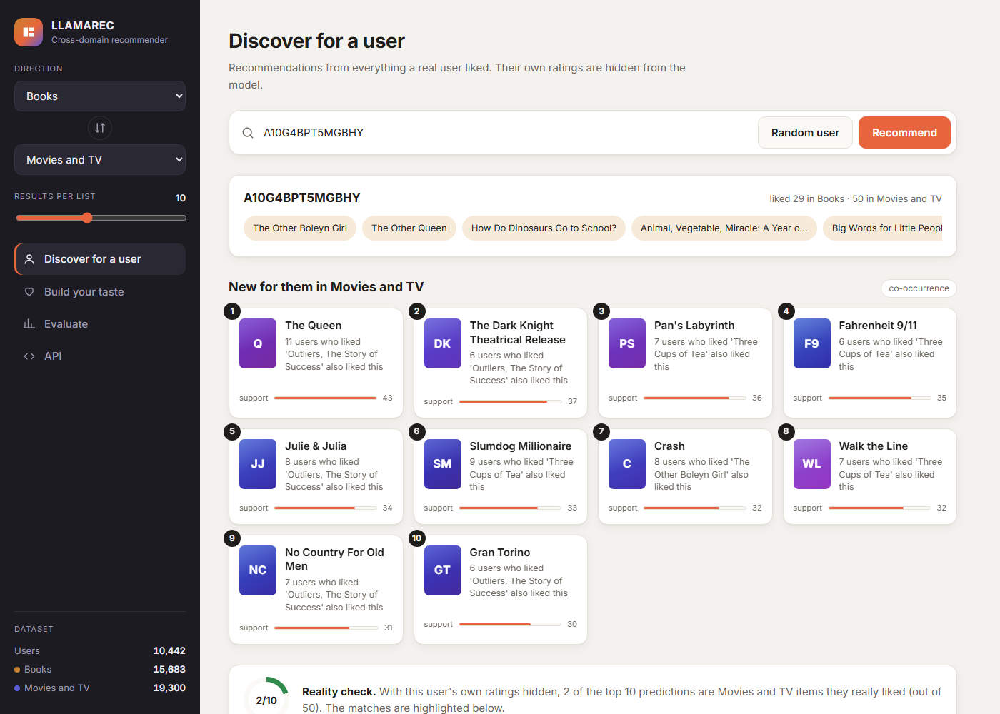
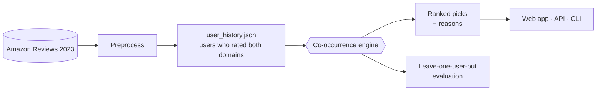
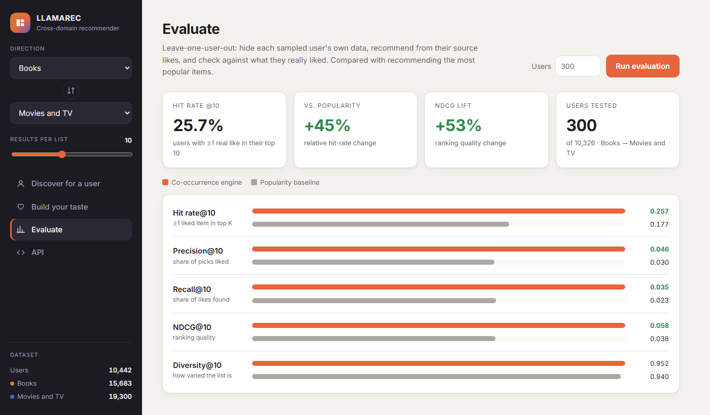

<div align="center">

# 🦙 LLAMAREC

**Cross-domain recommendations from real people's ratings.**<br>
Tell it the books someone loves, and it suggests films they're likely to enjoy, or the other way round, with a reason for every pick.

[](https://github.com/ThanigaiSingaravelan/llamarec-crossdomain/actions/workflows/ci.yml)


[Quick start](#-quick-start) · [How it works](#-how-it-works) · [Results](#-results) · [API](#-api) · [Project layout](#-project-layout) · [Citation](#-citation)

<br>

<picture>
  <source media="(prefers-color-scheme: dark)" srcset="docs/images/discover-dark.png">
  
</picture>

<sub>MSc Artificial Intelligence dissertation project · De Montfort University · 2025</sub>

</div>

<br>

## ✨ At a glance

| | |
|---|---|
| 🔀 **Books ⇄ Movies & TV** | Built from **10,442 Amazon users** who rated items in both domains: 15,683 books and 19,300 films and TV titles. |
| 💬 **Every pick is explained** | *"11 users who liked 'Outliers' also liked this"*, plus a bar showing how many users support it. |
| 🆕 **Works for new users** | Pick a few titles you like and get recommendations straight away. |
| 📊 **Honestly evaluated** | Leave-one-user-out testing against a popularity baseline: **+45% hit rate** for Books → Movies & TV. |
| ⚡ **Light and local** | No GPU, no LLM, no API keys. Loads in about a second and runs entirely on your machine. |

<br>

## 🚀 Quick start

```bash
git clone https://github.com/ThanigaiSingaravelan/llamarec-crossdomain.git
cd llamarec-crossdomain

python -m venv venv
venv\Scripts\activate          # macOS / Linux: source venv/bin/activate
pip install -r requirements.txt

python app.py check            # are the packages and data in place?
python app.py serve            # → http://127.0.0.1:5000
```

> [!NOTE]
> The app reads `data/splits/user_history.json`. The data folder isn't in the repository because of its size. To build it, download the **Books** and **Movies & TV** files from [Amazon Reviews 2023](https://huggingface.co/datasets/McAuley-Lab/Amazon-Reviews-2023) into `data/raw/` and run `python app.py preprocess all`.

<details>
<summary><b>All commands</b></summary>

<br>

| Command | What it does |
|---|---|
| `python app.py serve` | Start the web app and JSON API (`--port 5001` to change the port) |
| `python app.py check` | Check packages and data files |
| `python app.py recommend` | Recommendations for a random user in the terminal (`--user <id>`, `--source`, `--target`, `--num`) |
| `python app.py evaluate-engine` | Leave-one-user-out evaluation in both directions (`--k 10 --n 300`) |
| `python app.py preprocess all` | Raw Amazon files → processed CSVs → `data/splits/` |
| `python app.py ncf --domain Books` | Train and evaluate the Neural Collaborative Filtering baseline |
| `python app.py test` | Run the test suite |

</details>

<br>

## 🧠 How it works



The idea is *"people who liked these books also liked these films"*:

1. Take every item the user liked in the **source** domain.
2. Find the other users who liked those same items.
3. Count what **those** users liked in the **target** domain. More shared fans means a higher score. The score is lightly damped by overall popularity, so the list isn't just blockbusters.
4. Each pick keeps the source item that contributed most to it. That becomes the explanation.
5. If someone's tastes don't overlap with anyone, it falls back to the most popular items.

The engine is about 200 lines of plain Python in [`core/engine.py`](core/engine.py).

<br>

## 📊 Results

Each test user's own ratings are **hidden**. The engine recommends from what they liked in one domain, and the list is checked against what they really liked in the other. The same users are scored with a "recommend the most popular items" baseline.



**Top 10 recommendations, 300 random users per direction**

| Direction | Method | Hit rate | Precision | Recall | NDCG |
|---|---|---:|---:|---:|---:|
| Books → Movies & TV | **Co-occurrence** | **25.7%** | **0.046** | **0.035** | **0.058** |
| | Popularity | 17.7% | 0.030 | 0.023 | 0.038 |
| Movies & TV → Books | **Co-occurrence** | **24.3%** | **0.042** | **0.036** | **0.053** |
| | Popularity | 21.0% | 0.034 | 0.036 | 0.049 |

About **1 user in 4** finds something they genuinely liked in their top 10, based only on their ratings in the *other* domain. The gain over popularity is clear for Books → Movies & TV (+45%) and smaller in the reverse direction (+16%).

<sub>Reproduce with `python app.py evaluate-engine --k 10 --n 300`, or the **Evaluate** tab in the app. Hit rate is the share of users with at least one liked item in their top 10.</sub>

<br>

## 🔌 API

Everything in the web app goes through a small JSON API.

| Method | Endpoint | Purpose |
|---|---|---|
| `GET` | `/api/health` | Status, user count, domains |
| `GET` | `/api/domains` | Items and users per domain |
| `GET` | `/api/users?source=&target=&limit=&random=1` | List or sample users |
| `GET` | `/api/users/<id>` | One user's profile |
| `GET` | `/api/items/search?domain=&q=` | Search titles |
| `POST` | `/api/recommend` | Recommendations for a `user_id` or a list of `liked_asins` |
| `GET` | `/api/evaluate?source=&target=&k=&n=` | Run the evaluation |

```bash
curl -X POST http://127.0.0.1:5000/api/recommend \
  -H "Content-Type: application/json" \
  -d '{"source_domain": "Movies_and_TV", "target_domain": "Books", "k": 5, "liked_asins": ["B000003KHS"]}'
```

<details>
<summary><b>Example response</b></summary>

<br>

```json
{
  "source_domain": "Movies_and_TV",
  "target_domain": "Books",
  "seeds": [{ "asin": "B000003KHS", "title": "The Godfather VHS" }],
  "strategy": "co-occurrence",
  "recommendations": [
    {
      "asin": "0099279320",
      "title": "The GODFATHER / FORTUNATE PILGRIM",
      "reason": "11 users who liked 'The Godfather VHS' also liked this",
      "support": 11,
      "score": 6.9911,
      "because": { "asin": "B000003KHS", "title": "The Godfather VHS" }
    }
  ]
}
```

</details>

<details>
<summary><b>Use the engine from Python</b></summary>

<br>

```python
from core.data import load_user_history
from core.engine import CrossDomainEngine

engine = CrossDomainEngine(load_user_history("data/splits/user_history.json"))

result = engine.recommend_for_user("A10G4BPT5MGBHY", "Books", "Movies_and_TV", k=5)
for pick in result["recommendations"]:
    print(pick["title"], "—", pick["reason"])
```

</details>

**Shareable links:** `http://127.0.0.1:5000/#user=<id>` opens a user's recommendations directly, and `#evaluate` runs the evaluation.

<br>

## 🗂️ Project layout

```
llamarec-crossdomain/
├── app.py            command-line entry point
├── core/             recommendation engine, data loading, metrics
├── webapp/           Flask app: JSON API, page, styles, script
├── preprocessing/    raw Amazon data → processed CSVs → splits
├── evaluation/       NCF and content-based baselines, result-file evaluators
├── tests/            pytest suite, runs in CI on a small built-in dataset
├── results/          saved outputs from the dissertation experiments
├── docs/             project page and README images
└── data/             not in git, created by preprocessing
```

<br>

## 🧪 Development

```bash
pip install -r requirements-dev.txt
python app.py test     # 52 tests: engine, API, metrics, imports
flake8 .
```

Every push and pull request runs the tests on Python 3.10, 3.11 and 3.12 with GitHub Actions. The tests use a small hand-made dataset, so they don't need the Amazon data.

<br>

## 📜 Background

This started as an MSc dissertation asking whether a large language model (Llama 3, run locally) could transfer a person's taste from one domain to another. The outputs of those experiments are kept in [`results/`](results/). One finding was that warm users (3.83) and cold users (3.74) scored almost the same on the 5-point heuristic quality score (p = 0.34); see the [study report](results/cold_warm_study_report_20250530_111755.txt).

The current version replaces the LLM with a transparent, data-driven engine. It's faster, needs no GPU, and can be measured directly against what real users liked. The LLM code remains in the git history.

<br>

## 🛣️ Roadmap

- [x] Web app and JSON API
- [x] Explanations and support for every recommendation
- [x] Leave-one-user-out evaluation with a popularity baseline
- [x] Automated tests and CI
- [ ] Add CDs & Vinyl and Digital Music (already in `data/processed/`)
- [ ] Weight by star rating and review text, not just "liked"
- [ ] Compare against the NCF baseline on the same users
- [ ] Coverage and novelty metrics
- [ ] Docker image

<br>

## 📚 Citation

```bibtex
@mastersthesis{senthilkumar2025llamarec,
  title  = {LLAMAREC: Cross-Domain Recommendations Through Large Language Model Intelligence},
  author = {Senthil Kumar, Thanigai Singaravelan},
  school = {De Montfort University},
  year   = {2025},
  type   = {MSc Dissertation},
  note   = {Supervised by Dr Aboozar Taherkhani. https://github.com/ThanigaiSingaravelan/llamarec-crossdomain}
}
```

## 🙏 Acknowledgements

Dr Aboozar Taherkhani for supervising the project · De Montfort University for research support · McAuley Lab for the [Amazon Reviews 2023](https://huggingface.co/datasets/McAuley-Lab/Amazon-Reviews-2023) dataset · Meta AI for the Llama 3 models used in the original study.

## 📄 License

[MIT](LICENSE). Use, change and share freely; keep the copyright notice.

<br>

<div align="center">

Built by **[Thanigai Singaravelan Senthil Kumar](https://www.linkedin.com/in/than-tsv/)** · ⭐ Star the repo if you find it useful

</div>
