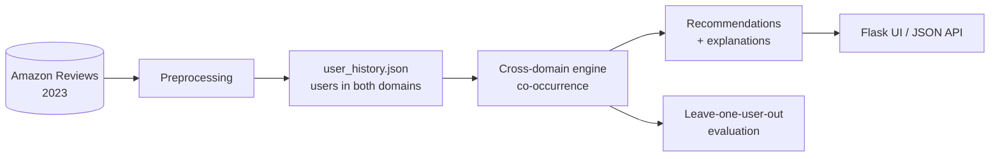

<div align="center">

# 🦙 LLAMAREC

### Cross-Domain Recommendations from Real User Ratings

*Recommend a film from someone's bookshelf. Recommend a book from their watchlist.*<br>
*Runs on your own machine, with an explanation for every pick.*

<br>

[](https://github.com/ThanigaiSingaravelan/llamarec-crossdomain/actions/workflows/ci.yml)


**MSc Artificial Intelligence Dissertation · De Montfort University · 2025**

[Overview](#-overview) · [How It Works](#-how-it-works) · [Quick Start](#-quick-start) · [Web App & API](#-web-app--api) · [Evaluation](#-evaluation) · [Results](#-results) · [Citation](#-citation)

</div>

---

## 📖 Overview

Most recommendation systems stay inside one category. If you have rated a hundred books, a typical system can suggest more books, but it has very little to say about which films you might enjoy.

LLAMAREC closes that gap using **10,442 real Amazon users who rated both Books and Movies & TV**. Give it what someone liked in one domain and it recommends items from the other, each with a reason such as *"11 users who liked 'Holes' also liked this"*.

It ships as a **Flask web app with a JSON API**. It needs no GPU, no LLM and no internet connection, and starts in about a second.

<table>
<tr>
<td width="50%" valign="top">

### 🔀 Cross-domain transfer
Books → Movies & TV and Movies & TV → Books, from real overlapping users.

### 💬 Explainable picks
Every recommendation names the liked item that led to it and how many users support it.

### 🆕 Cold start
New users can pick a few titles they like; with no overlap it falls back to popular items.

</td>
<td width="50%" valign="top">

### 🌐 Web UI + API
Recommend for a user, build your own taste, and run evaluations from the browser or over HTTP.

### 📊 Honest evaluation
Leave-one-user-out Precision, Recall, NDCG, hit rate and diversity, compared with a popularity baseline.

### 🔒 Private by design
Everything runs locally. No user data is sent to any external service.

</td>
</tr>
</table>

---

## ⚙️ How It Works



1. **Collect.** Amazon review data is cleaned and converted to CSV.
2. **Profile.** Users who rated items in both domains are found; their liked items are saved to `data/splits/user_history.json`.
3. **Recommend.** For each item you liked in the source domain, the engine finds other users who liked it and counts what *they* liked in the target domain. Scores are lightly damped by popularity, and each pick keeps the source item that contributed most to it, which becomes its explanation.
4. **Evaluate.** Each test user's own ratings are hidden, their recommendations are compared with what they really liked, and the same users are scored with a popularity baseline.

---

## 🗂️ Project Structure

<details>
<summary><b>Click to expand the folder layout</b></summary>

<br>

```
llamarec-crossdomain/
├── app.py              # Single entry point: python app.py <command>
├── core/               # Recommender engine, data loading, metrics
├── webapp/             # Flask web UI + JSON API
├── preprocessing/      # Raw Amazon data -> processed CSVs -> splits
├── evaluation/         # NCF + content-based baselines, result-file evaluators
├── tests/              # pytest suite (runs in CI, no data needed)
├── results/            # Saved experiment outputs (incl. the earlier LLM study)
├── docs/               # Project web page (GitHub Pages)
├── data/               # Not in git - created by preprocessing
└── .github/workflows/  # CI tests + Pages deploy
```

</details>

---

## 🚀 Quick Start

### Requirements

| | Minimum |
|---|---|
| **Python** | 3.10 |
| **RAM** | 4 GB to run the app, 16 GB to preprocess the full dataset |
| **Data** | `data/splits/user_history.json` (created by preprocessing) |

> 💡 The dataset is the [Amazon Reviews 2023](https://huggingface.co/datasets/McAuley-Lab/Amazon-Reviews-2023) collection from McAuley Lab on Hugging Face.

### 1 · Install

```bash
git clone https://github.com/ThanigaiSingaravelan/llamarec-crossdomain.git
cd llamarec-crossdomain

python -m venv venv
source venv/bin/activate        # Windows: venv\Scripts\activate

pip install -r requirements.txt
python app.py check
```

### 2 · Prepare the data (skip if `data/splits/user_history.json` exists)

Download the Amazon review files (Books, Movies & TV) and place them in `data/raw/`. The `data/` folder is git-ignored.

```bash
python app.py preprocess all         # raw -> processed -> splits
```

### 3 · Run the web app

```bash
python app.py serve
```

Open **http://127.0.0.1:5000**.

### 4 · Or use the terminal

```bash
python app.py recommend --source Books --target Movies_and_TV      # random user
python app.py recommend --user A100FKZWCI9ND6 --num 5
python app.py evaluate-engine --k 10 --n 300                        # both directions
python app.py ncf --domain Books                                    # NCF baseline
python app.py test                                                  # unit tests
```

Run `python app.py --help` for every command.

---

## 🌐 Web App & API

The UI has four tabs:

| Tab | What it does |
|---|---|
| **For a user** | Pick a user ID (or a random one) and see recommendations, plus a reality check of how many picks match what they really liked |
| **Pick what you like** | Search the catalogue, pick a few titles, get recommendations as a brand-new user |
| **Evaluate** | Run the leave-one-user-out evaluation against the popularity baseline |
| **API** | Endpoint reference with clickable examples |

| Method | Endpoint | Parameters |
|---|---|---|
| `GET` | `/api/health` | Status, user count, domains |
| `GET` | `/api/domains` | Items and users per domain |
| `GET` | `/api/users` | `source`, `target`, `limit`, `offset`, `random` |
| `GET` | `/api/users/<id>` | One user's profile |
| `GET` | `/api/items/search` | `domain`, `q`, `limit` |
| `POST` | `/api/recommend` | `{source_domain, target_domain, k, user_id` or `liked_asins, include_known}` |
| `GET` | `/api/evaluate` | `source`, `target`, `k`, `n` |

```bash
curl -X POST http://127.0.0.1:5000/api/recommend \
  -H "Content-Type: application/json" \
  -d '{"source_domain": "Movies_and_TV", "target_domain": "Books", "k": 5, "liked_asins": ["B000003KHS"]}'
```

The history file location can be changed with the `LLAMAREC_USER_HISTORY` environment variable.

<details>
<summary><b>Use the engine from Python</b></summary>

<br>

```python
from core.data import load_user_history
from core.engine import CrossDomainEngine

engine = CrossDomainEngine(load_user_history("data/splits/user_history.json"))

rec = engine.recommend_for_user("A100FKZWCI9ND6", "Books", "Movies_and_TV", k=5)
for r in rec["recommendations"]:
    print(r["title"], "-", r["reason"])

print(engine.evaluate("Books", "Movies_and_TV", k=10, n_users=300)["methods"])
```

</details>

---

## 📏 Evaluation

| Category | Metric | What it tells you |
|---|---|---|
| **Ranking** | Precision@K | How many of the top K picks were relevant |
| | Recall@K | How many of the user's liked items were found |
| | NDCG@K | Whether the best items were ranked near the top |
| **Diversity** | Intra-list diversity | How different the picks are from each other |
| | Coverage | How much of the catalogue gets recommended overall |
| | Novelty | How far the picks move away from the user's history |
| **Ranking** | Hit rate@K | Share of users with at least one relevant item in their top K |

**Baselines:** popularity (built into the engine evaluation), Neural Collaborative Filtering (NCF) and content-based filtering.

---

## 🏆 Results

### Data-based engine (this app)

Leave-one-user-out, 300 random users per direction, top 10 recommendations. Reproduce with `python app.py evaluate-engine --k 10 --n 300`.

| Direction | Method | Hit rate@10 | Precision@10 | Recall@10 | NDCG@10 |
|---|---|---:|---:|---:|---:|
| Books → Movies & TV | **Co-occurrence** | **0.253** | **0.045** | **0.034** | **0.057** |
| | Popularity | 0.177 | 0.030 | 0.023 | 0.038 |
| Movies & TV → Books | **Co-occurrence** | **0.243** | **0.042** | **0.036** | **0.054** |
| | Popularity | 0.210 | 0.034 | 0.036 | 0.049 |

About one user in four gets at least one item they really liked in their top 10, from their other-domain ratings alone. The gain over popularity is clear for Books → Movies & TV (+43% hit rate) and smaller for Movies & TV → Books (+16%).

### Earlier LLM study (dissertation, `results/`)

The original dissertation prompted a local Llama 3 model. That code has been retired from this repository (it remains in the git history); its saved outputs are in `results/`.

| Finding | Detail |
|---|---|
| 💬 **Explanations** | Over 95% of LLM recommendations came with a reason tied to the user's source preferences. |
| 🔥 **Warm vs cold** | In the `llama3.1:8b` study (33 users, 39 prompts) warm users scored 3.83 vs 3.74 for cold users on the 5-point heuristic quality score. The difference was not statistically significant (t = −0.97, p = 0.34); see [results/cold_warm_study_report_20250530_111755.txt](results/cold_warm_study_report_20250530_111755.txt). |

---

## 🛣️ Roadmap

**Features**
- [ ] Recommendations that use images as well as text
- [ ] Real-time serving
- [ ] Fine-tuning support
- [ ] More domains, such as games and electronics
- [ ] Web interface
- [ ] API endpoint for other apps

**Research**
- [ ] Conversational recommendations
- [ ] Causal analysis of cross-domain transfer
- [ ] Tracking user satisfaction over time
- [ ] Checking for cultural and demographic bias

---

## 🤝 Contributing

Contributions are welcome. Open an issue or pull request.

```bash
pip install -r requirements-dev.txt

python app.py test          # or: python -m pytest

black .
flake8 .
```

---

## 📚 Citation

If LLAMAREC helps your research, please cite it:

```bibtex
@mastersthesis{senthilkumar2025llamarec,
  title  = {LLAMAREC: Cross-Domain Recommendations Through Large Language Model Intelligence},
  author = {Senthil Kumar, Thanigai Singaravelan},
  school = {De Montfort University},
  year   = {2025},
  type   = {MSc Dissertation},
  note   = {Supervised by Dr Aboozar Taherkhani. Available at https://github.com/ThanigaiSingaravelan/llamarec-crossdomain}
}
```

---

## 🙏 Acknowledgements

- **Dr Aboozar Taherkhani** for supervising the project
- **De Montfort University** for research support and resources
- **Meta AI** for the Llama 3 model family
- **McAuley Lab** for the public Amazon Reviews dataset

---

## 📄 License

This project is released under the [MIT License](LICENSE). You are free to use, change and share the code, as long as you keep the copyright notice.

---

<div align="center">

Built by **[Thanigai Singaravelan Senthil Kumar](https://www.linkedin.com/in/than-tsv/)**

⭐ If you found this useful, a star on the repo is always appreciated.

</div>
